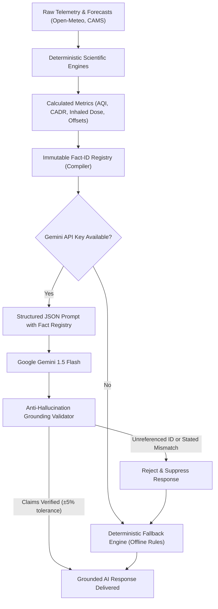

# VayuSenseX — Grounded Generative AI Architecture

## 1. Core Engineering Principle

> **"The deterministic engine owns the calculations. GenAI owns the explanations. The user owns the decisions."**

In severe environmental health emergencies (such as urban winter smog in Delhi NCR or the Indo-Gangetic Plain), hallucinated numbers can directly harm families. If an LLM fabricates safe AQI levels, invents false purifier filtration capacities, or miscalculates inhaled particulate doses, users may make perilous behavioral choices.

VayuSenseX enforces an architectural barrier between mathematical calculation and natural language synthesis.

---

## 2. The Grounding Pipeline Architecture

---

## 3. Fact-ID Registry Specification

Before any LLM invocation, VayuSenseX compiles all deterministic physics outputs into an immutable `FactRegistry`. Each entry receives an authorized, immutable Fact ID:

| Fact ID | Metric | Source Engine | Provenance |
| :--- | :--- | :--- | :--- |
| `OBS_PM25` | Current Ambient PM2.5 | Atmospheric Telemetry | `FORECAST` / `OBSERVED` |
| `OBS_CPCB_AQI` | Central Pollution Control Board NAQI | CPCB NAQI Engine | `CALCULATED` |
| `OBS_USEPA_AQI` | US EPA Air Quality Index | US EPA Breakpoints | `CALCULATED` |
| `INDOOR_STEADY_PM25` | Steady-State Indoor PM2.5 | Single-Zone ODE Mass Balance | `CALCULATED` |
| `PLAN_CLEANEST_START` | Cleanest Time Window Start Hour | Routine Time-Window Engine | `CALCULATED` |
| `PLAN_PEAK_START` | Peak Smog Inversion Window | Diurnal Dispersion Heuristic | `CALCULATED` |
| `PLAN_DOSE_BEFORE` | Baseline Daily Inhaled Dose | EPA Inhaled Dose Engine | `CALCULATED` |
| `PLAN_DOSE_AFTER` | Optimized Daily Inhaled Dose | Schedule Optimization Engine | `CALCULATED` |
| `PLAN_DOSE_REDUCTION_PCT`| Particulate Dose Reduction % | Schedule Optimization Engine | `CALCULATED` |

---

## 4. Anti-Hallucination Grounding Validator

The Grounding Validator inspects every response produced by Gemini prior to rendering:

1. **Fact-ID Integrity:** Every quantitative claim made by the model must cite an active `factId` existing in the current `FactRegistry`.
2. **Numerical Tolerance Check:** The numerical claim made by the model ($V_{stated}$) is compared against the ground-truth value ($V_{true}$) stored in the registry:
   $$\text{Error} = \frac{|V_{stated} - V_{true}|}{\max(1.0, |V_{true}|)}$$
   If $\text{Error} > 0.05$ (5% discrepancy), the entire LLM response is rejected.
3. **Automatic Fallback:** Upon validation failure, network timeout, rate limiting, or key absence, the system instantaneously supplies the verified deterministic briefing without disrupting the user experience.

---

## 5. Offline Deterministic Fallback Engine

VayuSenseX does not require an active internet connection or external API keys to deliver personalized natural language decision support.

The deterministic fallback engine (`src/services/ai/ai-fallback.ts`):
- Composes evidence-based executive briefings from template trees grounded directly in CPCB health advisories.
- Dynamically formats personalized guidance based on family member sensitivity tiers (`CHILD`, `OLDER_ADULT`, `HIGH`).
- Implements comprehensive query routing for common urban inquiries (window ventilation timing, outdoor workout safety, CPCB vs US EPA differences, and purifier CADR sizing).
